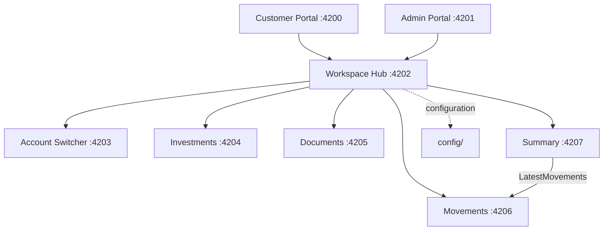

# Architecture

## Applications

Nexus is an Angular workspace with two shells and six microfrontends:

| Application | Role | Port |
|---|---|---:|
| `customer-portal` | Customer shell | 4200 |
| `admin-portal` | Admin shell | 4201 |
| `workspace-hub` | MFE orchestrator | 4202 |
| `account-switcher` | Account selection MFE | 4203 |
| `investments` | Investments MFE | 4204 |
| `documents` | Documents MFE | 4205 |
| `movements` | Account activity MFE | 4206 |
| `summary` | Financial summary MFE | 4207 |

The shells provide the portal context and navigation. They load `Workspace Hub`, which composes the feature MFEs according to the active portal and view.

## Runtime composition

The shells and remotes are independent Angular projects. Each federated application has its own `federation.config.js` and exposes its federated component. `Movements` also exposes `./LatestMovements`, which is consumed directly by `Summary`.

Composition uses `loadRemoteModule` and `NgComponentOutlet` through Native Federation. It does not use iframes, `postMessage`, or Shadow DOM. The hub uses explicit `remoteEntry.json` URLs for nested federation so that remote resolution is deterministic.

## Communication

Runtime communication uses typed `CustomEvent` objects in the same browser window:

- `account-changed`
- `portal-changed`
- `workspace-view-changed`

Shared event and domain types are defined in [`shared/contracts/src/index.ts`](../shared/contracts/src/index.ts). The current contract version is `1.0.0`. MFEs own their UI and business implementation; they communicate through the shared contracts rather than importing another MFE's components or business classes.

## Portal composition

- **Customer Portal:** Account Switcher, Investments, Documents, Movements, and Summary.
- **Admin Portal:** Account Switcher, Documents, Movements, and Summary.

Investments remains available as a remote, but it is not part of the default Admin Portal navigation.

## Federation and configuration

Native Federation is provided by `@angular-architects/native-federation`. Runtime endpoints are maintained in:

- [`config/mfe-registry.json`](../config/mfe-registry.json)
- [`public/federation.manifest.json`](../public/federation.manifest.json)
- [`projects/admin-portal/public/federation.manifest.json`](../projects/admin-portal/public/federation.manifest.json)

Portal-specific feature configuration is stored in:

- [`config/portal-config.customer.json`](../config/portal-config.customer.json)
- [`config/portal-config.admin.json`](../config/portal-config.admin.json)

All applications currently run locally on the ports listed above. The lab scripts perform health checks before reusing or starting a service; runtime state and logs are stored under `.runtime/`.
