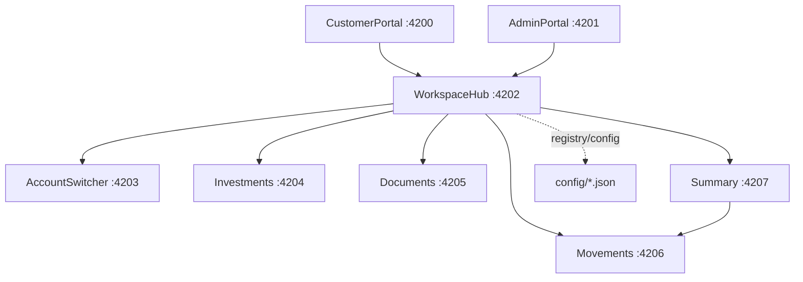

# Arquitectura

Los Shells solo aportan identidad visual, navegación, contexto y estados. Ambos cargan `WorkspaceHub` mediante `loadRemoteModule`; el hub carga los MFEs como componentes federados mediante `loadRemoteModule` y `NgComponentOutlet`. No se usan iframes ni Shadow DOM.

Cada MFE es un proyecto Angular independiente con `federation.config.js`. Los remotes exponen `./Component` mediante Native Federation 21.2.6. Movements expone además `./LatestMovements`, que Summary consume directamente. La cadena de composición se resuelve con `remoteEntry.json` explícitos para evitar ambigüedades en la federación anidada.

Summary, Documents, Movements e Investments se montan según la vista activa; Account Switcher permanece en WorkspaceHub. Los contratos no comparten componentes ni clases de negocio: solo tipos en `shared/contracts/src/index.ts`, con versión `1.0.0`.

La comunicación runtime utiliza eventos `CustomEvent` en la misma ventana: `account-changed`, `portal-changed` y `workspace-view-changed`. Strategy aparece en Movements para presentar los datos de forma distinta en customer y admin. WorkspaceHub coordina la carga, el contexto y los estados de cada remote.

Trade-off: Native Federation permite despliegue y evolución independiente, pero exige compatibilidad de Angular, nombres remotos, contratos y endpoints. El laboratorio mantiene manifests JSON como referencia para escenarios standalone; la composición principal usa URLs explícitas y health checks locales.
