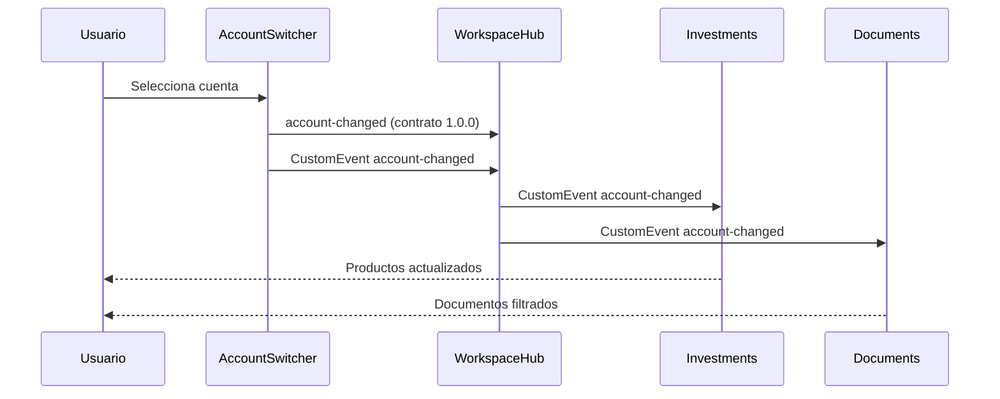

# Comunicación

`AccountSwitcher` emite un `CustomEvent('account-changed')` con la cuenta seleccionada en `detail`. `WorkspaceHub`, Summary, Investments, Documents y Movements escuchan el evento y actualizan su cuenta sin importar la implementación del selector. Si un receptor todavía no está cargado, el emisor sigue funcionando; WorkspaceHub vuelve a emitir el contexto al montar una vista nueva.

`portal-changed` selecciona la estrategia de presentación de Movements y `workspace-view-changed` coordina la navegación del shell con WorkspaceHub. Esta solución evita `postMessage` porque todos los componentes se montan en la misma ventana. Si el sistema creciera, el bus podría extraerse a una librería compartida manteniendo los mismos nombres y payloads. Los datos ficticios nunca contienen secretos.
